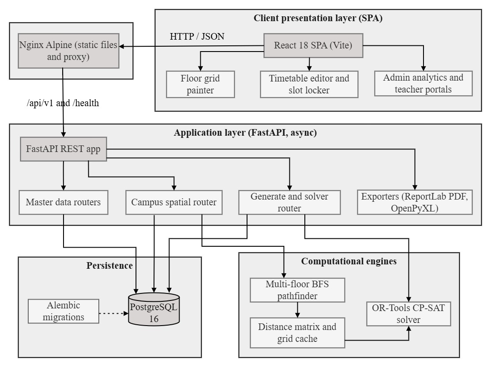

# Technical Documentation & System Architecture Specification
## Automated College Timetable Scheduler & Campus Spatial Optimization Platform

**Document Version:** 1.0.0  
**Classification:** Technical System Design Document  
**Last Updated:** November 2026  

---

## Table of Contents

1. [Executive Summary & Problem Domain](#1-executive-summary--problem-domain)
2. [System Architecture & Top-Level Design](#2-system-architecture--top-level-design)
3. [Data Architecture & Database Schema](#3-data-architecture--database-schema)
4. [Constraint Optimization Engine (Google OR-Tools CP-SAT)](#4-constraint-optimization-engine-google-or-tools-cp-sat)
5. [Campus Spatial Engine & Graph Pathfinding](#5-campus-spatial-engine--graph-pathfinding)
6. [API Architecture & REST Endpoint Catalog](#6-api-architecture--rest-endpoint-catalog)
7. [Frontend Architecture & UI Subsystems](#7-frontend-architecture--ui-subsystems)
8. [Document Export & Reporting Subsystems](#8-document-export--reporting-subsystems)
9. [DevOps, Containerization & Deployment](#9-devops-containerization--deployment)
10. [Performance, Scalability & Resilience](#10-performance-scalability--resilience)

---

## 1. Executive Summary & Problem Domain

### 1.1 The Academic Timetabling Challenge
The University Course Timetabling Problem (UCTP) is an **NP-hard** combinatorial optimization challenge. In any tertiary educational institution, constructing a feasible weekly schedule requires reconciling:
- Multiple departments sharing faculty, lecture halls, and specialized laboratories.
- Curricular requirements consisting of theoretical lectures and continuous multi-period laboratory practicals.
- Teacher contractual work limits, unavailabilities, and subject preference affinities.
- Student cohort requirements, ensuring no section is double-booked or overloaded on any single weekday.

### 1.2 The Spatial Transit Problem
Standard academic scheduling software treats campus facilities as abstract nodes with zero physical distance. In large collegiate campuses, back-to-back classes scheduled for an instructor in distant buildings or on disparate floor levels lead to severe transit delays and faculty fatigue.

### 1.3 System Mission
This platform solves both dimensions simultaneously:
1. Formulates the discrete assignment problem into a mathematical Constraint Satisfaction and Optimization Problem (**COP**) solved via **Google OR-Tools CP-SAT**.
2. Incorporates an interactive **2D Campus Floor Grid Painter** that builds an interconnected multi-building graph, computing real-world walking distances via **Breadth-First Search (BFS)** and **Dijkstra's Algorithm**, and minimizing transit distances in consecutive periods as a soft solver objective.

---

## 2. System Architecture & Top-Level Design

The system employs a decoupled, asynchronous client-server architecture:



### Architectural Principles
1. **Asynchronous Non-Blocking I/O**: The backend uses Python AsyncIO with `asyncpg` and SQLAlchemy 2.0 async sessions to handle concurrent master data queries and analytics aggregation without thread starvation.
2. **Decoupled Heavy Compute**: Timetable generation and spatial graph evaluations run dedicated Python worker routines utilizing compiled C++ binaries from Google OR-Tools.
3. **Stateless REST Services**: All generation requests are assembled into immutable payload contracts (`TimetableRequest`), enabling deterministic debugging and reproducible solve benchmarks.

---

## 3. Data Architecture & Relational Schema Specifications

The database is structured in PostgreSQL 16 across three core domains: **Academic Master Data**, **Spatial Campus Infrastructure**, and **Timetable Results & Slots**.

### 3.1 Academic Entities
- **`departments`**: Master academic divisions (`id`, `name`, `code`, `created_at`, `updated_at`).
- **`staffrooms`**: Designated teacher common rooms associated with a department (`id`, `department_id`, `label`).
- **`subjects`**: Course catalog entries.
  - `weekly_periods`: Base required lecture periods per week.
  - `lab`: Boolean flag indicating laboratory designation.
  - `lab_consecutive_periods`: Required consecutive periods per lab session (e.g., 2 or 3).
  - `weekly_lab_sessions`: Number of independent lab blocks required per week.
  - `required_lab_type`: Required hardware/specialization classification (e.g., `computer`, `mechanical`, `chemistry`).
- **`teachers`**: Faculty members.
  - `max_periods_per_week`: Hard upper bound on total weekly assigned teaching periods.
- **`teacher_subjects`**: Join table mapping teachers to subjects with preference weighting:
  - `preference_rank`: Integer (1 = primary preference, higher = secondary/tertiary).
  - `preference_type`: Enum string (`'preferred'`, `'willing'`, `'avoid'`).
- **`teacher_unavailable_slots`**: Unavailability blackout windows (`teacher_id`, `day_of_week` [0..4], `period_index` [0..N]).
- **`rooms`**: Physical facilities (`name`, `code`, `room_type` [`'classroom'`, `'lab'`, `'seminar'`], `lab_type`, `capacity`).
- **`class_sections`**: Student cohorts (`name`, `code`, `strength`, `homeroom_id` [FK to `rooms`]).
- **`class_section_subjects`**: Section curriculum mapping with optional `weekly_periods_override`.

### 3.2 Spatial Campus Entities
- **`campuses`**: Root geographic entity (`id`, `name`, `description`).
- **`buildings`**: Structures within a campus (`name`, `code`, `pos_x`, `pos_y`, `width`, `height`, `color`).
- **`floors`**: Individual building levels:
  - `level`: Integer floor index (0 = Ground).
  - `grid_rows`, `grid_cols`: Dimensions of the 2D painter matrix (bounds: 5 to 200).
  - `cell_size_m`: Real-world scale factor (e.g., 1 cell = 1.0 meter).
  - `grid_data`: Serialized JSON matrix (`list[list[str]]`) containing cell classifications.
  - `room_links`: Serialized JSON array linking painted cell blobs to `rooms.id` or `staffrooms.id`.
  - `stair_connections`: Serialized JSON declaring cross-floor vertical connections.
  - `gate_labels`: Serialized JSON mapping gate coordinates to labels.
- **`inter_building_distances`**: High-level walking distance matrix between building pairs.
- **`entrance_pair_distances`**: Fine-grained walking distances between specific floor gates across buildings.

### 3.3 Timetable Output Entities
- **`timetables`**: Generation run record (`status` [`'ok'`, `'infeasible'`, `'timeout'`], `solver_wall_ms`, `message`, `created_at`).
- **`timetable_slots`**: Individual period assignments (`timetable_id`, `section_id`, `subject_id`, `teacher_id`, `room_id`, `day_of_week`, `period_index`, `is_locked`).

---

## 4. Constraint Optimization Engine (Google OR-Tools CP-SAT)

The scheduler formulates timetabling as a discrete Constraint Satisfaction and Optimization Problem (**COP**).

### 4.1 Decision Variable Formulations

Let:
- $S$: Set of all class sections.
- $U$: Set of all subjects.
- $T$: Set of all teachers.
- $R$: Set of all rooms.
- $D$: Set of working days ($d \in \{0, \dots, \text{num\_days} - 1\}$).
- $P$: Set of periods per day ($p \in \{0, \dots, \text{periods\_per\_day} - 1\}$).

#### 4.1.1 Non-Lab Variables
For non-lab subjects, variables are defined per period:
$$\mathbf{X}_{s, u, t, r, d, p} \in \{0, 1\}$$
$\mathbf{X} = 1$ if section $s$ is taught subject $u$ by teacher $t$ in room $r$ on day $d$ at period $p$.
*(Room $r$ is deterministically constrained to the section's `homeroom_id` for standard lectures).*

#### 4.1.2 Lab Block Variables
For laboratory subjects requiring $K$ consecutive periods ($K = \text{lab\_consecutive\_periods}$):
$$\mathbf{L}_{s, u, t, r, d, p} \in \{0, 1\} \quad \forall p \in \{0, \dots, |P| - K\}$$
$\mathbf{L} = 1$ indicates a continuous lab session initiates at period $p$ and spans slots $p, p+1, \dots, p+K-1$ in specialized room $r$.

---

### 4.2 Hard Constraints (Mathematical Specification)

The CP-SAT model strictly enforces constraints $C_1$ through $C_6$:

#### $C_1$: Curriculum Coverage
For every section-subject pair $(s, u)$ requiring $N_{s,u}$ periods:
- **Non-Lab Subject:**
  $$\sum_{t} \sum_{r} \sum_{d} \sum_{p} \mathbf{X}_{s, u, t, r, d, p} = N_{s,u}$$
- **Lab Subject ($B_{s,u}$ sessions of duration $K$):**
  $$\sum_{t} \sum_{r} \sum_{d} \sum_{p=0}^{|P|-K} \mathbf{L}_{s, u, t, r, d, p} = B_{s,u}$$

#### $C_2$: Teacher No-Double-Booking
At any specific day $d$ and period $p$, an instructor $t$ can be assigned to at most one section:
$$\sum_{s, u, r} \mathbf{X}_{s, u, t, r, d, p} + \sum_{s, u, r} \sum_{k=0}^{\min(p, K-1)} \mathbf{L}_{s, u, t, r, d, p-k} \le 1 \quad \forall t, d, p$$

#### $C_3$: Section No-Double-Booking
A student section $s$ can attend at most one lecture or lab simultaneously:
$$\sum_{u, t, r} \mathbf{X}_{s, u, t, r, d, p} + \sum_{u, t, r} \sum_{k=0}^{\min(p, K-1)} \mathbf{L}_{s, u, t, r, d, p-k} \le 1 \quad \forall s, d, p$$

#### $C_4$: Room & Lab Exclusivity
A physical room or laboratory $r$ can host at most one active class during period $p$:
$$\sum_{s, u, t} \mathbf{X}_{s, u, t, r, d, p} + \sum_{s, u, t} \sum_{k=0}^{\min(p, K-1)} \mathbf{L}_{s, u, t, r, d, p-k} \le 1 \quad \forall r, d, p$$

#### $C_5$: Teacher Unavailability Blackout
For every blocked slot $(d, p) \in \text{Unavailable}(t)$:
$$\mathbf{X}_{s, u, t, r, d, p} = 0 \quad \text{and} \quad \mathbf{L}_{s, u, t, r, d, p-k} = 0 \quad (\forall k \in [0, K-1])$$

#### $C_6$: Teacher Weekly Workload Cap
The total scheduled teaching hours for teacher $t$ cannot exceed their limit $M_t$:
$$\sum_{s, u, r, d, p} \mathbf{X}_{s, u, t, r, d, p} + \sum_{s, u, r, d, p} \left( K \cdot \mathbf{L}_{s, u, t, r, d, p} \right) \le M_t \quad \forall t$$

---

### 4.3 Soft Optimization Objectives (Cost Function)

The overall objective minimizes total penalty $\Phi = \Phi_{\text{spread}} + \Phi_{\text{pref}} + \Phi_{\text{transit}}$:

#### $O_1$: Balanced Weekly Spread ($\Phi_{\text{spread}}$)
To prevent subject clustering on single days:
$$\text{FairShare}_{s,u} = \left\lceil \frac{N_{s,u}}{|D|} \right\rceil$$
$$\text{DayLoad}_{s,u,d} = \sum_{t, r, p} \mathbf{X}_{s, u, t, r, d, p} + \sum_{t, r, p} \mathbf{L}_{s, u, t, r, d, p}$$
$$\text{Excess}_{s,u,d} \ge \text{DayLoad}_{s,u,d} - \text{FairShare}_{s,u}, \quad \text{Excess}_{s,u,d} \ge 0$$
$$\Phi_{\text{spread}} = W_{\text{spread}} \cdot \sum_{s, u, d} \text{Excess}_{s,u,d}$$

#### $O_2$: Teacher Preference Affinity ($\Phi_{\text{pref}}$)
Rewards preferred pairings and penalizes avoided assignments:
- If preference is `'preferred'` with rank $R \ge 1$: Bonus $= \lfloor B_{\text{base}} / R \rfloor$ (subtracted from objective).
- If preference is `'avoid'`: Flat penalty $P_{\text{avoid}}$ (added to objective).
- If preference is `'willing'`: Cost is 0.

#### $O_3$: Campus Walking Distance Minimization ($\Phi_{\text{transit}}$)
Minimizes walking distance between consecutive periods $p$ and $p+1$ on the same day for instructor $t$:
$$\Phi_{\text{transit}} = W_{\text{transit}} \cdot \sum_{t, d, p} \text{Distance}\left(\text{Room}_{t, d, p}, \text{Room}_{t, d, p+1}\right)$$
The distance metric is dynamically sourced from the **Campus Spatial Engine** matrix.

---

### 4.4 Slot Locking & Differential Generation

The system supports pinning approved slots ($\text{is\_locked} = \text{true}$):
1. **Pre-Solve Injection**: Locked slots are extracted from the database and injected into `TimetableRequest.locked_slots`.
2. **Variable Clamping**: During model construction, `apply_locked_slots()` fixes the corresponding decision variable $\mathbf{X}_{s, u, t, r, d, p} = 1$ and clamps conflicting variables in that slot to 0.
3. **Differential Re-Solve**: The solver explores the remaining search space, ensuring zero alterations to pinned allocations.

---

## 5. Campus Spatial Engine & Graph Pathfinding

### 5.1 Cell Taxonomy & Representation
Floors are stored as 2D coordinate arrays ($R \times C$). Each cell has a discrete type:
- `wall`: Non-walkable obstacle.
- `corridor`: Fully walkable thoroughfare.
- `door`: Room entry/exit boundary cell (target node for BFS room ingress).
- `stairs`: Vertical transition hub connecting designated floor levels.
- `gate` / `entrance`: Building perimeter boundary cell for inter-building traversal.
- `room` / `staffroom`: Interior facility cells.

### 5.2 Distance Computation Hierarchy
To compute $\text{Distance}(Node_A, Node_B)$:

1. **Intra-Floor (Same Floor)**:
   - 4-directional **Breadth-First Search (BFS)** across walkable cells (`corridor`, `door`, `stairs`, `gate`).
   - Distance in cells multiplied by `cell_size_m` (meters/cell).

2. **Inter-Floor (Same Building, Different Floors)**:
   - Evaluates paths through shared `stair_connections`.
   $$\text{Dist}(A, B) = \text{BFS}(A, \text{Stair}_i^{\text{Floor A}}) + \text{Penalty}_{\text{stair}} + \text{BFS}(\text{Stair}_i^{\text{Floor B}}, B)$$
   Default `Penalty_stair = 15` cells per floor elevation.

3. **Inter-Building (Different Buildings)**:
   - Looks up `entrance_pair_distances` for specific gate-to-gate connections.
   - Falls back to `inter_building_distances` if explicit gate paths are undefined.
   - Falls back to 2D Euclidean distance between building coordinates ($pos\_x, pos\_y$) if manual distances are omitted.

### 5.3 Caching Subsystems
- **`FloorBFSGraphCache`**: Caches all-pairs door/stair BFS distances per floor. Automatically invalidated via SHA-256 hash checks on `grid_data`.
- **`CampusMatrixCache`**: Precomputes and retains full $N \times N$ room-to-room distance matrices for solver objective evaluation.

---

## 6. API Architecture & REST Endpoint Catalog

The backend exposes an OpenAPI 3.0-compliant RESTful interface prefixed at `/api/v1`.

### 6.1 Route Inventory

| Module | Method | Endpoint | Description |
|---|---|---|---|
| **Health** | `GET` | `/health` | Service health status and version verification |
| **Generation** | `GET` | `/api/v1/generate-timetable/health` | Verifies OR-Tools library initialization |
| | `GET` | `/api/v1/generate-timetable/payload` | Pre-assembles active DB records into `TimetableRequest` |
| | `POST` | `/api/v1/generate-timetable` | Executes CP-SAT solver, persists output, returns result |
| **Timetables** | `GET` | `/api/v1/timetables` | Paginated list of generated timetable runs |
| | `GET` | `/api/v1/timetables/{id}` | Detailed slots for a timetable run |
| | `GET` | `/api/v1/timetables/{id}/section/{section_id}` | Timetable filtered by class section |
| | `GET` | `/api/v1/timetables/{id}/teacher/{teacher_id}` | Timetable filtered by instructor |
| | `GET` | `/api/v1/timetables/{id}/room/{room_id}` | Room utilization schedule |
| | `POST` | `/api/v1/timetables/{id}/slots/{slot_id}/lock` | Pins/locks a specific schedule slot |
| | `POST` | `/api/v1/timetables/{id}/slots/{slot_id}/unlock` | Unlocks a pinned slot |
| | `GET` | `/api/v1/timetables/{id}/export/xlsx` | Downloads styled multi-sheet Excel workbook |
| | `GET` | `/api/v1/timetables/{id}/export/pdf` | Downloads print-ready ReportLab PDF document |
| **Campus** | `GET` | `/api/v1/campuses` | Lists campuses |
| | `POST` | `/api/v1/campuses` | Creates a new campus entity |
| | `GET` | `/api/v1/buildings` | Lists buildings with campus map coordinates |
| | `POST` | `/api/v1/buildings` | Creates or updates building positions and bounding boxes |
| | `GET` | `/api/v1/floors/{id}` | Retrieves floor record including painted `grid_data` |
| | `PUT` | `/api/v1/floors/{id}/grid` | Saves serialized 2D painter grid and room blob links |
| | `POST` | `/api/v1/campus/compute-distances` | Triggers campus-wide BFS distance recalculation |
| **Teachers** | `GET` | `/api/v1/teachers` | Lists faculty members with departments and work caps |
| | `POST` | `/api/v1/teachers` | Registers new faculty profile |
| | `PUT` | `/api/v1/teachers/{id}/preferences` | Updates subject preference ranks and affinity types |
| | `PUT` | `/api/v1/teachers/{id}/unavailability` | Sets blackout periods (day of week, period index) |
| **Subjects** | `GET` | `/api/v1/subjects` | Course catalog with lecture and lab session requirements |
| | `POST` | `/api/v1/subjects` | Creates course subject definition |
| **Rooms** | `GET` | `/api/v1/rooms` | Classrooms and specialized laboratories |
| | `POST` | `/api/v1/rooms` | Creates room with capacity and facility classification |
| **Sections** | `GET` | `/api/v1/class-sections` | Student cohorts with assigned homeroom and curriculum |
| **Analytics** | `GET` | `/api/v1/analytics/workload` | Teacher weekly period distribution metrics |
| | `GET` | `/api/v1/analytics/room-utilization` | Facility utilization percentages and heatmaps |
| | `GET` | `/api/v1/analytics/transit-stats` | Faculty inter-period walking distance averages |

---

## 7. Frontend Architecture & UI Subsystems

The frontend is an enterprise Single Page Application built on React 18, Vite, and Tailwind CSS.

### 7.1 Component Hierarchy & Routing
- `/`: **`Dashboard.jsx`** — System statistics, rapid navigation, and status overview.
- `/generate`: **`Generate.jsx`** — Solver execution control, timeout parameterization, and diagnostic output.
- `/campus`: **`CampusLayout.jsx`** — Multi-building overview canvas and floor selector.
- `/analytics`: **`AdminAnalytics.jsx`** — Interactive heatmaps (Recharts) for room loads and faculty distribution.
- `/teacher-portal`: **`TeacherDashboard.jsx`** — Instructor-facing personal timetable, room-to-room transit guides, and substitution request forms.
- `/requests`: **`Requests.jsx`** — Administrative workflow to review, approve, or reject schedule adjustments.
- Master Management Views:
  - `Teachers.jsx`, `Subjects.jsx`, `Rooms.jsx`, `ClassSections.jsx`, `Departments.jsx`.

### 7.2 Floor Grid Painter Engine (`FloorGridPainter.jsx`)
- **Direct Canvas / Grid Manipulation**: Renders configurable $M \times N$ matrix grids.
- **Tool Palette**: Wall drawing, corridor clearing, door placement, stairwell declaration, and gate placement.
- **Blob Detection & Entity Linking**: Groups contiguous room cells into distinct spatial blobs and maps them to database room records (`room_links`).
- **Validation Pipeline**: Checks that all rooms have at least one valid walkable door connecting to the corridor network before allowing grid persistence.

---

## 8. Document Export & Reporting Subsystems

Export processing is centralized in `backend/exporter.py`:

### 8.1 Excel Generation (`openpyxl`)
- **Multi-Sheet Workbooks**: Emits separate sheets for Master Campus, Departmental schedules, and individual Class Sections.
- **Visual Distinction**: Color codes theory lectures, multi-period laboratory blocks, and break slots.
- **Metadata Framing**: Injects teacher names, room codes, and timestamps into merged schedule headers.

### 8.2 PDF Document Generation (`reportlab`)
- **Custom Page Layouts**: High-resolution landscape tables formatted with precise cell padding and point sizing.
- **Dynamic Flowables**: Automatic pagination splitting for institutions with large numbers of student sections.
- **Print Optimization**: Strict monochrome and high-contrast color palettes suitable for physical bulletin board posting.

---

## 9. DevOps, Containerization & Deployment

### 9.1 Multi-Container Orchestration (`docker-compose.yml`)

The production deployment consists of three isolated container environments connected through an internal bridge network:

```yaml
services:
  db:
    image: postgres:16-alpine
    container_name: timetable_db
    restart: always
    environment:
      POSTGRES_USER: postgres
      POSTGRES_PASSWORD: postgrespassword
      POSTGRES_DB: timetable_db
    ports:
      - "5432:5432"
    volumes:
      - postgres_data:/var/lib/postgresql/data
    healthcheck:
      test: ["CMD-SHELL", "pg_isready -U postgres -d timetable_db"]
      interval: 5s
      timeout: 5s
      retries: 5

  backend:
    build:
      context: ./backend
      dockerfile: Dockerfile
    container_name: timetable_backend
    restart: always
    environment:
      DATABASE_URL: postgresql+asyncpg://postgres:postgrespassword@db:5432/timetable_db
      APP_ENV: production
    ports:
      - "8000:8000"
    depends_on:
      db:
        condition: service_healthy

  frontend:
    build:
      context: ./frontend
      dockerfile: Dockerfile
    container_name: timetable_frontend
    restart: always
    ports:
      - "5173:80"
    depends_on:
      - backend
```

### 9.2 Migration Lifecycle (`docker-entrypoint.sh`)
When the backend container initializes, `docker-entrypoint.sh` runs:
```bash
#!/bin/sh
set -e
echo "Running database migrations..."
alembic upgrade head
echo "Starting FastAPI server..."
exec uvicorn main:app --host 0.0.0.0 --port 8000
```
This ensures zero downtime and automatic schema synchronization on container rollouts.

---

## 10. Performance, Scalability & Resilience

### 10.1 Solver Complexity & Timeouts
- **NP-Hard Mitigation**: Real-world university data can yield $>100,000$ boolean decision variables. The CP-SAT solver applies SAT presolve simplifications, clause learning, and parallel search workers.
- **Configurable Time Limits**: The generation API accepts a `max_solver_duration_seconds` parameter (default: 30s to 120s). If the optimal solution is not proven before the timeout, CP-SAT returns the best feasible solution found along with its optimality gap.

### 10.2 Database Performance & Indexing
- Foreign key columns (`timetable_id`, `teacher_id`, `section_id`, `room_id`) are indexed to support fast filtering across large historical schedules.
- Heavy relations use SQLAlchemy `selectinload` strategy to avoid $N+1$ query overhead during full payload assembly.

### 10.3 Failure Mode Handling
- **Infeasibility Diagnostics**: When conflicting constraints make a schedule mathematically impossible (e.g., total required periods exceed room or teacher availability), the solver returns status `'infeasible'` and logs the exact unsatisfied constraints for user resolution.
- **Database Safety**: Deletion of master records uses soft cascades (`ondelete="SET NULL"`) on `timetable_slots`, ensuring historic timetable records are preserved even if rooms or instructors are retired.

